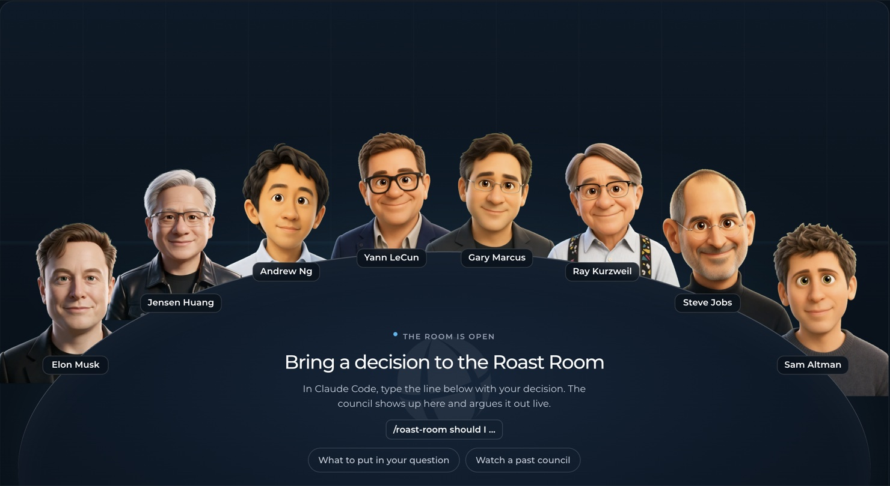

# Roast Room



Bring a hard business decision and a council of AI advisors argues it out, then hands you a scored verdict and a one-click PDF. Nineteen advisors ship with it, each built from that person's public work: their letters, essays, talks, and videos. For each question, the Chair picks who should sit on the council and tells you why. The council runs in [Claude Code](https://claude.com/claude-code) or [Kiro CLI](https://kiro.dev), and a small local web app shows them around a table talking it through. Want someone else at the table? Ask for a new roaster by name, and the agent builds that advisor the same way.

| Seat | Pillar | The question they own |
|---|---|---|
| Jensen Huang | Platform bets and long-horizon compute | Is this a market you can create and own early, and can you endure the years it takes? |
| Andrew Ng | Applied AI and fast iteration | Where does AI actually create value in this business, and how fast can you test it? |
| Yann LeCun | AI science and open platforms | Can the technology really do this today, and should you build it open? |
| Gary Marcus | AI reliability and hype check | What breaks when the AI is wrong, and is the promise real or hype? |
| Ray Kurzweil | Exponential trends and the long future | Where will the curve be when this ships, and are you building for that point? |
| Elon Musk | First principles and execution speed | What is the real constraint here, and can we cut steps and build it faster? |
| Steve Jobs | Product taste and focus | Is this insanely great, and what are you saying no to? |
| Sam Altman | Ambition and compounding bets | Is this ambitious enough, and will it compound as the technology gets better? |

Those eight are the **default board**. Eleven more advisors are on call, and the Chair brings them in when your question is in their lane:

| Seat | Pillar | The question they own |
|---|---|---|
| Jeff Bezos | Strategy and decisions | Is this the right bet, and how reversible is it? |
| Paul Graham | Product and startups | Do people actually want this, and is it growing? |
| Alex Hormozi | Offers, pricing, and sales | Will people pay, how much, and how do we close? |
| Gary Vaynerchuk | Marketing and attention | Where does the attention come from? |
| Dan Martell | People, hiring, and founder time | Who does this, and what does it cost your calendar? |
| Gino Wickman | Operations and scaling | Can the business run this without you holding it together? |
| Warren Buffett | Money and capital | What does it do to cash, risk, and long-term value? |
| Naval Ravikant | Leverage and wealth | Does this build leverage and equity you own, or does it just rent out your time? |
| Codie Sanchez | Buying and owning small businesses | Should you build this, or buy something that already works? |
| Sara Blakely | Consumer product and brand from zero | Will customers love it enough to sell it for you, without outside money? |
| Leila Hormozi | Leadership and scaling teams | Can your team and your leadership carry this, and who has to change? |

## What you need

- One agent runtime:
  - [Claude Code](https://claude.com/claude-code). Your Claude plan covers it; no API key needed.
  - Or [Kiro CLI](https://kiro.dev) (`kiro-cli`). Seat agents and skills for it ship in `.kiro/`.
- [Node.js](https://nodejs.org) 20 or newer, for the room. There's nothing to install beyond that.
- Optional: Python 3, for the quote checker (`check_quotes.py`). Without it, the Chair checks quotes by hand.

## Setup

```bash
git clone https://github.com/nateherkai/roast-room.git
cd roast-room
```

Or open Claude Code anywhere and say: "Clone github.com/nateherkai/roast-room and start the room for me."

Using Kiro CLI? Generate the agents once, so the paths in them point at your clone:

```bash
node .kiro/scripts/sync_agents.mjs
```

## Run a roast

1. Start the room: `npm start`, then open http://localhost:4730. Leave it open.
2. Open your agent in the same folder: `claude`, or `kiro-cli chat --agent roast-room` (see [Run it in Kiro CLI](#run-it-in-kiro-cli)).
3. Type `/roast-room` and your decision (in Kiro: `roast room` and your decision).
4. Watch the council argue it out in the room. The Chair only stops to ask if your question is missing key facts (in Kiro autopilot, it never stops).
5. When the verdict lands, click **Download PDF**.

You also get a short verdict in chat, and the full report lands in `sessions/<date>-<decision>/verdict.md`.

## What to put in your question

The council is only as good as what you give it. Include:

- **The decision** in one line.
- **Your options.** Two or three. "Keep doing what I do now" counts.
- **Your numbers.** Revenue, cash, and team size.
- **Your limits.** Deadline, hours, and budget.
- **What success looks like**, and by when.
- **Which way you're leaning**, and why. The council tests your lean instead of agreeing with it.

Left something out? The Chair asks before the council starts (or, in Kiro autopilot, fills the gap with a marked assumption). Example:

```
/roast-room I run a coaching business at $30k a month with 15 clients at $2,000 each.
Should I raise to $3,500 for everyone, raise for new clients only, or keep $2,000?
Close rate is about 50% and I have $40k in the bank. Success is $45k a month by March.
I'm leaning toward raising for everyone because I'm underpaid.
```

More ways to run it:

- `/roast-room --quick ...` seats four advisors for two rounds. Use it for smaller, reversible calls. It uses far less of your plan.
- `/roast-room --seats hormozi,buffett ...` seats only the advisors you name.
- `/roast-room ask hormozi ...` gets one answer from one seat. It shows in chat only; the room plays full councils, not single answers.
- `/roast-room --all ...` seats every advisor you have (up to nine).
- `/roast-room board` shows who sits at the table by default and lets you change it.

The room is optional. The council runs the same without it.

## Choose who sits at the table

When you run `/roast-room`, the Chair reads your question and picks a council from every advisor you have, with one line on why each one fits. Every council keeps a seat that guards your downside and one that's likely to disagree, so the room argues instead of nodding. A pricing question might get Hormozi, Buffett, Codie Sanchez, Sara Blakely, and Graham. A hiring question might get Leila Hormozi, Martell, Wickman, Naval, and Buffett. An AI build-or-buy question might get Andrew Ng, Gary Marcus, Yann LeCun, Jensen Huang, and Buffett.

How the board gets picked is a setting in `.claude/skills/roast-room/roster.json`:

```json
{
  "board": "auto",
  "default": ["huang", "ng", "lecun", "marcus", "kurzweil", "musk", "jobs", "altman"],
  "seats": [ ...every advisor you have... ]
}
```

| Setting | What happens on every `/roast-room` |
|---|---|
| `"auto"` (current) | The Chair picks the council and tells you who and why, without asking. |
| `"ask"` | The Chair recommends a council and asks you to pick: the recommended board, your default board, everyone (when you have nine or fewer), or your own changes ("recommended, but add Naval and drop Wickman"). |
| `"default"` | Your default board sits every time. No question. |

You don't need to edit the file by hand. Type `/roast-room board` and say what you want: "put Naval on my default board", "take Gary V off", or "ask me each time".

Override it on any run: `--seats hormozi,naval,buffett` seats exactly those advisors, and `--all` seats everyone (up to nine). `--quick` picks four.

## Add your own advisor

```
/newroaster Morgan Housel
```

The agent builds a new seat the way the original seven were built:

1. **Asks two or three questions**: the business pillar and question the advisor owns (it suggests one), whether they join your default board, and how deep to go.
2. **Finds their public work**: essays, letters, talks, long interviews, and podcasts where they are the main speaker.
3. **Fetches it** into `build/<name>/`, a local folder git ignores. Web pages become text and YouTube videos become transcripts.
4. **Extracts how they think**: parallel sub-agents read every source and pull out their frameworks, rules, positions, stories, and voice, with verbatim quotes.
5. **Writes the brain** (`.claude/skills/roast-room/brains/<name>/`) and checks that every quote is word for word in the source it cites.
6. **Writes the advisor's agent** (`.claude/agents/council-<name>.md`) and adds them to `roster.json`.
7. **Makes their portrait** for the room from a real photo, in the same cartoon style as the other advisors.
8. **Tests the new seat** on a sample question, then tells you how to use it.

| Depth | Sources | Good for |
|---|---|---|
| `--quick` | 12 to 20 | Trying someone out |
| default | 30 to 50 | An advisor you'll use |
| `--deep` | 80+ | Matching the original seven |

A standard build is about 8 to 10 sub-agent runs, so it uses a real share of your plan. When it finishes, open a new session so the advisor loads as its own agent (the council works before that too). In Kiro CLI, say `newroaster Morgan Housel`; it also runs `node .kiro/scripts/sync_agents.mjs` to write the seat's Kiro agent. Then use them like anyone else: `/roast-room ask housel ...`, `/roast-room --seats housel,buffett,hormozi ...`, or put them on your default board. The Chair also starts picking them when a question fits their pillar.

You can build an advisor from public figures, living or historical, with a real body of public work, or from your own material (your posts, transcripts, notes) if you want yourself or a consenting mentor on the board. The raw sources stay on your machine; only the brain, which holds short quotes and paraphrase, is meant to be committed.

**Their face in the room:** `/newroaster` also makes the new advisor's cartoon portrait, the same way the original seven were made. It finds a real photo of the person, turns it into the same 3D cartoon style (using one of the existing cartoons as the style reference), picks the closest likeness, and makes the talking frames (mouth open, mouth "oh", and a blink). This step needs a [kie.ai](https://kie.ai/api-key) key in `.env` (`KIE_AI_API_KEY=`, about 5 image jobs per advisor) and Python with `opencv-python` (the agent installs it if it's missing). Or use GPT Image 2 on your own Azure OpenAI deployment instead: set `PORTRAIT_BACKEND=azure`, `AZURE_OPENAI_ENDPOINT`, `AZURE_OPENAI_API_KEY`, and `AZURE_OPENAI_IMAGE_DEPLOYMENT` in `.env` (the style comes out a little warmer). Without a key the advisor still works and shows a placeholder face; add a key later and run `/newroaster portrait <name>`.

YouTube transcripts and photos work best with [yt-dlp](https://github.com/yt-dlp/yt-dlp) installed, and PDFs need `pdftotext` ([Poppler](https://poppler.freedesktop.org)). Both are optional: without them, the agent falls back to YouTube's own captions and reads PDFs itself.

## Run it in Kiro CLI

The council runs in Kiro CLI with the same brains, prompts, scoring, and room. Kiro has no custom slash commands, so type the commands as plain text: `roast room <decision>`, `roast room ask <seat> ...`, `roast room board`, `newroaster <name>`.

```bash
node .kiro/scripts/sync_agents.mjs     # once, and after adding or editing a seat
npm start                              # the room, in another terminal
kiro-cli chat --agent roast-room
> roast room --quick Should we ...
```

- **`roast-room` agent (autopilot Chair).** Runs the whole council in one go: it never stops to ask, picks the board itself, and fills missing facts with assumptions marked `(assumed)`, listed in the verdict so you can rerun with real numbers. Reads, searches, and subagent calls are auto-approved. Writes are auto-approved only under `sessions/` and for `roster.json`. Shell is auto-approved only for the quote checker and `mkdir -p sessions/...`; anything else still asks you.
- **Seat agents** (`.kiro/agents/council-<key>.json`). One per seat, generated from `.claude/agents/council-<key>.md`. Each reads only its brain and may write only its own card under `sessions/`.
- **Interactive mode.** Plain `kiro-cli chat` in this folder also works through the skills in `.kiro/skills/`. It asks for missing facts and asks before tool use.
- **How the cards travel.** Kiro's subagent tool returns a summary, not the full card, so each seat writes its card to `sessions/<session>/cards/round-<N>/<key>.md`, and the Chair builds the round files from those.
- The generated agent files contain the absolute path of your clone. If you move the folder, run `sync_agents.mjs` again.

## Watch an example first

Run `npm start`, open http://localhost:4730, and click **Past sessions**. Three finished councils ship with the repo, so you can see how it works (and download their PDFs) before you run your own.

## How it works

- **The council runs in Claude Code or Kiro CLI.** Each seat is a sub-agent (`.claude/agents/council-*.md`, listed in `roster.json`, mirrored for Kiro in `.kiro/agents/`) that reads its own brain (`.claude/skills/roast-room/brains/<name>/`): frameworks, principles, positions, stories, and voice notes compiled from public sources, with every quote tied to a source. The agent acts as the Chair. It runs the rounds, keeps score, and writes the verdict (`.claude/skills/roast-room/SKILL.md`; Kiro follows it through `.kiro/skills/roast-room/SKILL.md`).
- **Each seat scores every option**, weighted by how much that seat's pillar matters to your decision. The Chair caps the verdict when a seat flags ruin risk, and it forces a real argument when everyone agrees too fast.
- **The room only watches.** As the Chair works, it writes each step to `sessions/`, and the app plays those files back. Between rounds it shows which round is running, how long it has been, and what each advisor is weighing. The room makes no AI calls of its own.
- **Every council is saved** in `sessions/`. Past sessions replays any of them and downloads its PDF.
- **Usage:** a full council is three sub-agent runs per seat (24 for the default board of eight), so it takes a real bite out of your plan's usage. Use `--quick` for small calls.

## Optional: let the room run councils itself

If you'd rather type a decision straight into the room, copy `.env.example` to `.env`, add an `ANTHROPIC_API_KEY`, set `COUNCIL_RUNNER=api`, and restart `npm start`. That mode bills your Anthropic API account (about 25 calls per full council).

## What's inside

| Path | What |
|---|---|
| `.claude/skills/roast-room/` | The council skill: protocol, prompts, scoring, report template, and one brain per advisor |
| `.claude/skills/roast-room/roster.json` | Every advisor, your default board, and how the board is picked |
| `.claude/skills/newroaster/` | The `/newroaster` skill and its scripts: fetch sources, check quotes, register a seat |
| `.claude/agents/` | One agent per advisor (`council-<name>.md`) |
| `.kiro/agents/` | Kiro CLI agents: the autopilot Chair (`roast-room.json`) and one per advisor, generated |
| `.kiro/skills/` | Kiro CLI versions of the `roast-room` and `newroaster` skills (they follow the `.claude` protocol) |
| `.kiro/scripts/sync_agents.mjs` | Regenerates the Kiro agents from `.claude/agents/` and `roster.json` |
| `app/` | The room: a zero-dependency Node server, the web page, and the PDF builder |
| `sessions/` | Your councils (kept out of git) and the three examples |
| `build/` | Raw sources `/newroaster` fetched (kept out of git) |

## About the advisors

These are simulations built from each person's public work, and so is any advisor you add. They are not the people, they don't speak for them, and none of them is affiliated with or endorses this project. A seat only quotes a person verbatim when the line is in its brain with a source, and `python .claude/skills/roast-room/scripts/check_quotes.py sessions/<session>` checks every quote in a council against the brains. Each brain's `sources.md` lists what it was built from.

Built by AI Automation Society. The code is MIT licensed; see `LICENSE`. The PDF builder bundles [jsPDF](https://github.com/parallax/jsPDF) (MIT) and [Montserrat](https://github.com/JulietaUla/Montserrat) (SIL Open Font License); their licenses sit next to them in `app/public/`.
